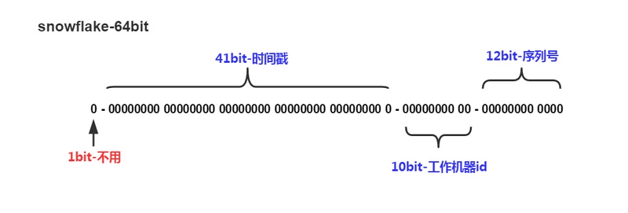

雪花算法
====

*[官方源码地址-scala](https://github.com/twitter-archive/snowflake/tree/snowflake-2010)


## id由以下内容组成：
* 时间 - 41位（毫秒精度w /自定义时代给我们69年）
* 配置的机器ID - 10位 - 最多可为我们提供1024台机器
* 序列号 - 12位 - 每台机器每4096个滚动一次（带有保护以避免在相同的时间内翻转）

<br>



## 具体解释：
* `1位不用`<br>
  二进制中最高位为1的都是负数,但是我们生成的id一般都使用整数,所以这个最高位固定是0。

* `41位用来记录时间戳(毫秒)`<br>
  41位可以表示$2^{41}-1$个数字<br>
  如果只用来表示正整数（计算机中正数包含0），可以表示的数值范围是：0 至 $2^{41}-1$，减1是因为可表示的数值范围是从0开始算的，而不是1。<br>
  也就是说41位可以表示$2^{41}-1$个毫秒的值，转化成单位年则是$(2^{41}-1) / (1000 * 60 * 60 * 24 * 365) = 69年。

* `10位用来记录工作机器id`<br>
  可以部署在$2^{10} = 1024$个节点，包括`5位datacenterId`和`5位workerId`<br>
  5位（bit）可以表示的最大正整数是$2^{5}-1 = 31$，即可以用0、1、2、3、....31这32个数字，来表示不同的datecenterId或workerId

* `12位序列号`，用来记录同毫秒内产生的不同id<br>
  12位（bit）可以表示的最大正整数是$2^{12}-1 = 4095$，即可以用0、1、2、3、....4094这4095个数字，来表示同一机器同一时间截（毫秒)内产生的4095个ID序号


## 比较详细的解释

*[理解分布式id生成算法SnowFlake](https://segmentfault.com/a/1190000011282426?utm_source=tag-newest)
<br>

## 多进程下用zookeeper获取workerID

    Zookeeper分布式锁应用了临时顺序节点
    
    锁的名称 disLocks1_lock_0000000355
    
    zkCli.sh 进入客户端 ls /locks
    
### 步骤
* 在zookeeper指定节点（locks）下创建临时顺序节点node_n
* 获取locks下所有子节点children
* 对子节点按节点自增序号从小到大排序
* 判断本节点是不是第一个子节点，若是，则获取锁；若不是，则监听比该节点小的那个节点的删除事件
* 若监听事件生效，则回到第二步重新进行判断，直到获取到锁


# 使用方式
```
    使用如下返回一个ID
    
    SnowflakeId.generateId()
``` 
    
## 需要修改的地方

* 修改 `SnowflakeId 102行`<br>
  DistributedLock lock = new DistributedLock(FlowWriteConfig.ZOOKEEPER_SERVERS, "disLocks1")<br>
  第一个参数为 zookeeper地址 第二个参数为锁的前缀

* 修改 `SnowflakeId 104行`<br>
  int tmpWorkerId = zookeeperUtils.modifyNode("/Snowflake/" + FlowWriteConfig.KAFKA_TOPIC);<br>
  将FlowWriteConfig.KAFKA_TOPIC 替换为你想要的名称 /为划分节点的表示，固名称不可带 ` / `

* 修改 `SnowflakeId 108行`<br>
  int dataCenterId = FlowWriteConfig.DATA_CENTER_ID_NUM;<br>
  替换为你的数据中心地址，任务与任务之间分离，例如任务1 此值为1；任务2 此值为2

* 修改 `ZookeeperUtils 74行`<br>
   zookeeper = new ZooKeeper(FlowWriteConfig.ZOOKEEPER_SERVERS, SESSION_TIME_OUT, this);<br>
  FlowWriteConfig.ZOOKEEPER_SERVERS 替换为你的zookeeper地址

